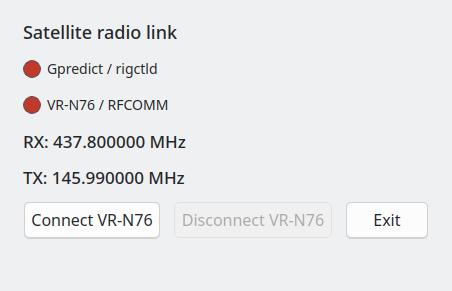

# gpredict-vrn76-bridge

A bridge between **Gpredict** (or another rigctld-compatible client) and
the **VR-N76** handheld transceiver. It connects to the radio over Bluetooth
Classic SPP/RFCOMM and provides a local rigctld-compatible TCP server.


## Requirements

- Linux
- Go 1.20 or later
- Qt 6 Widgets, `pkg-config`, and a C++17-compatible compiler for the GUI build
- `sdptool` (optional; used to discover the SPP channel. If unavailable, the
bridge tries RFCOMM channel 1.)

## Build and test

```sh
make build
make test
```

## Run

Start with the graphical interface:

```sh
./gpredict-vrn76-bridge -address <MAC_ADDR_OF_VNR76>
```

The GUI displays connection status and RX/TX frequencies. Click **Connect
VR-N76** to connect to the radio. The rigctld-compatible TCP server starts when
the program starts.

Run without the GUI and attempt to connect to the radio immediately:

```sh
./gpredict-vrn76-bridge -headless
```

Example with explicit settings:

```sh
./gpredict-vrn76-bridge \
  -address 38:D2:00:01:2F:3A \
  -host 127.0.0.1 \
  -port 4532 \
  -headless
```

## Options

| Option | Default | Description |
|---|---:|---|
| `-address` | `38:D2:00:01:2F:3A` | VR-N76 Bluetooth address |
| `-host` | `127.0.0.1` | TCP server bind address |
| `-port` | `4532` | rigctld-compatible server TCP port |
| `-rx-frequency` | `437800000` | Initial RX frequency in Hz |
| `-tx-frequency` | `145990000` | Initial TX frequency in Hz |
| `-transport` | `classic-raw` | Radio transport; `classic-raw` and `classic` use SPP/RFCOMM. BLE is unsupported. |
| `-rfcomm-channel` | `0` | Explicit SPP RFCOMM channel (1–30); `0` attempts SDP discovery |
| `-verbose` | `false` | Enable debug logging |
| `-headless` | `false` | Run without the Qt window and immediately attempt to connect to the radio |

For the complete options list, run `./gpredict-vrn76-bridge --help`.

## Connect Gpredict

By default, the bridge listens only on the local machine at `127.0.0.1:4532`.
Configure Gpredict (or its rigctld connection) to use that host and port. To
make the server reachable from other machines, set `-host` accordingly and
secure access to the TCP port.

## Notes

- If `sdptool` is unavailable or SPP channel discovery fails, the bridge tries
channel 1. You can set a channel explicitly with `--rfcomm-channel`.
- RX and TX frequencies are specified in hertz.



